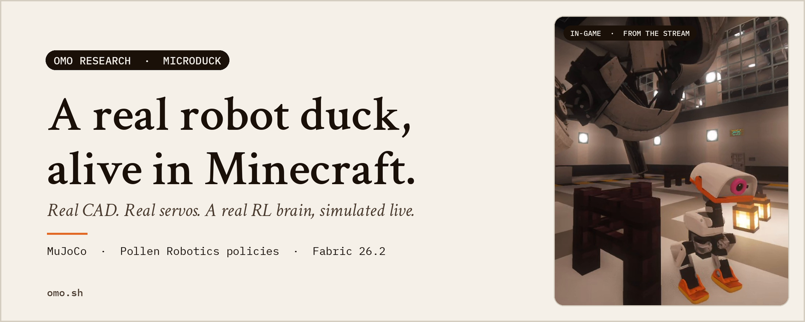
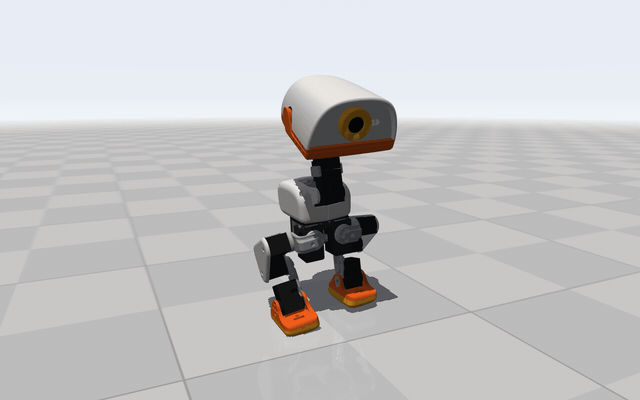
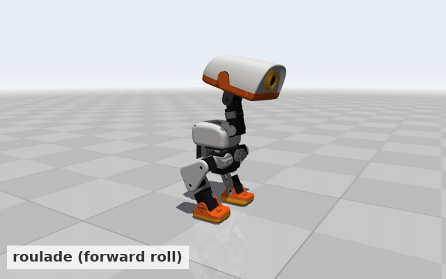
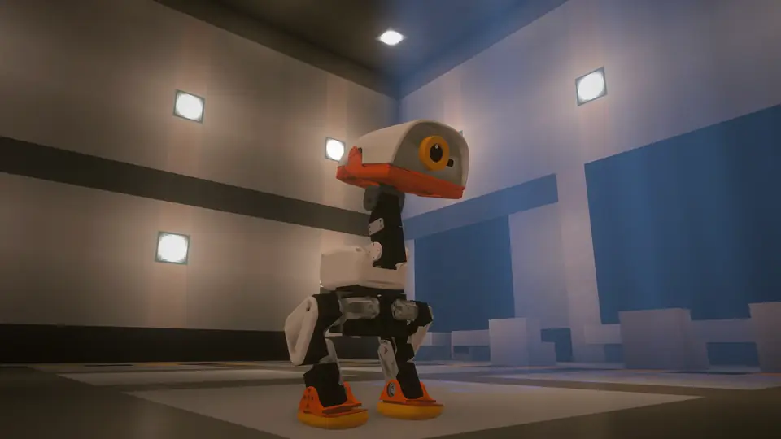
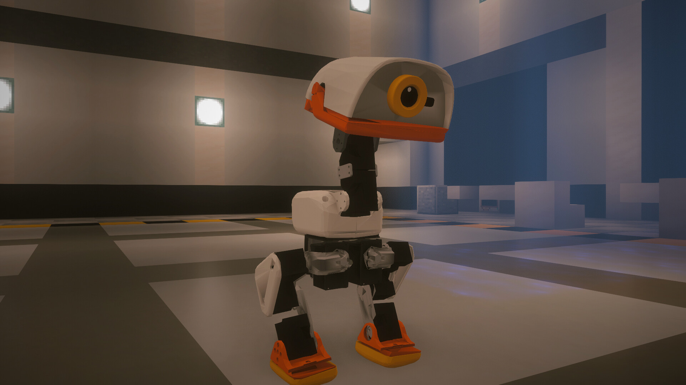
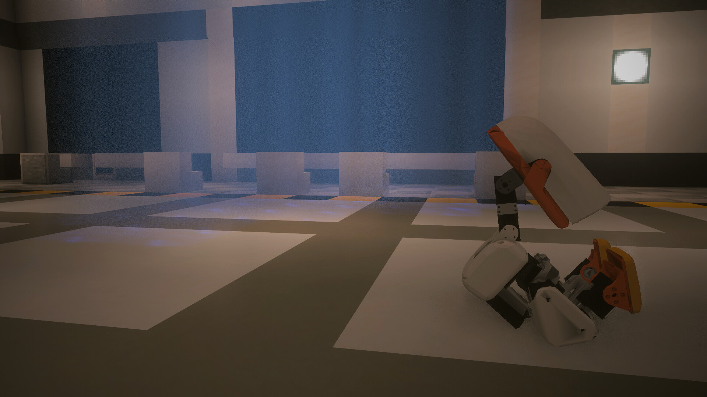
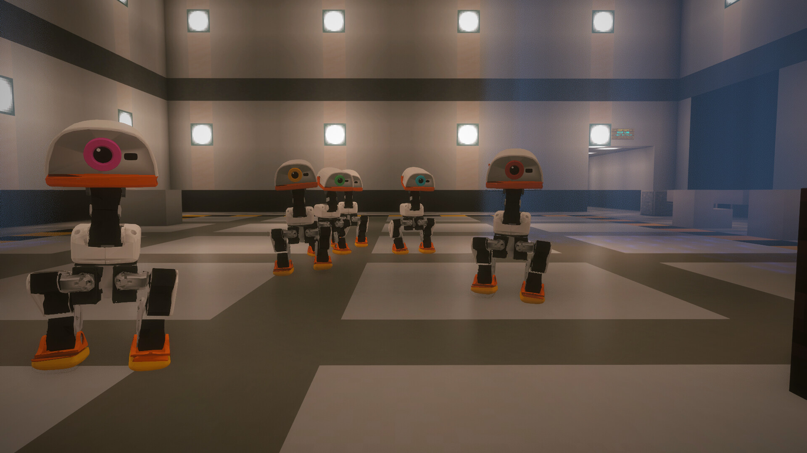
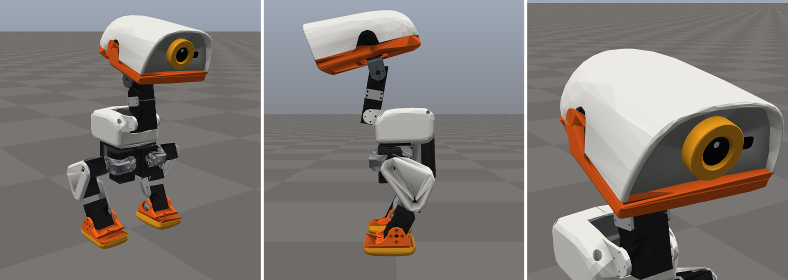
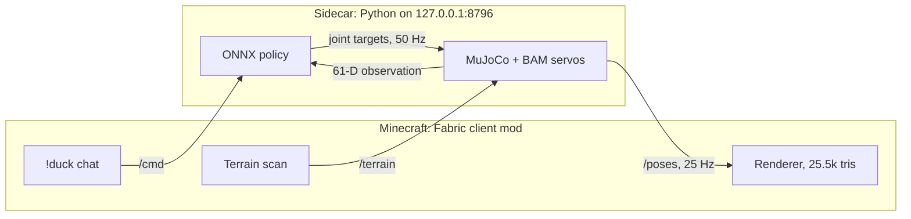

<p align="center">
  
</p>

<h1 align="center">Omo Microduck</h1>

<p align="center">
  Not a mob. Not an animation. The actual open-source <b>Pollen Robotics Microduck</b>,<br>
  its real CAD, its real servos and its real RL brain, simulated live in MuJoCo and walking on your blocks.
</p>

<p align="center">
  <a href="https://github.com/omoresearch/omo-microduck/releases/latest"><b>Download v1.0.0</b></a>
  &nbsp;·&nbsp;
  <a href="#quick-start">Quick start</a>
  &nbsp;·&nbsp;
  <a href="#how-it-works">How it works</a>
  &nbsp;·&nbsp;
  <a href="https://www.omo.sh">omo.sh</a>
</p>

<p align="center">
  <a href="https://github.com/omoresearch/omo-microduck/releases/latest"></a>
  
  
  
  
</p>

---

<table>
<tr>
<td width="50%"></td>
<td width="50%"></td>
</tr>
<tr>
<td align="center"><sub><b>It walks because it learned to.</b> Pollen's <code>velstand</code> policy, 50 times a second.</sub></td>
<td align="center"><sub><b>And it learns new tricks.</b> Rolls, hops, dances: community brains from Hugging Face.</sub></td>
</tr>
</table>

## In the game

<p align="center">
  <a href="https://github.com/omoresearch/omo-microduck/releases/download/v1.0.0/omo-microduck-in-game.mp4"></a>
</p>

<table>
<tr>
<td width="33%"></td>
<td width="33%"></td>
<td width="33%"></td>
</tr>
</table>

<p align="center">
  <a href="https://github.com/omoresearch/omo-microduck/releases/download/v1.0.0/omo-microduck-in-game.mp4"><b>▶ Watch the 55-second in-game film</b></a> (1080p, release asset)
</p>

<sub>Recorded inside Minecraft 26.2 (Fabric, Iris + Complementary Reimagined shaders) in the Omo Space duck lab.
The camera path is scripted; the duck is not. Every step, hop and roll is the policy driving live MuJoCo physics,
drawn by this mod. Captured at ⅓ wall-clock speed on a busy machine (sim clock and game tick slowed together,
physics timestep unchanged) and retimed to real speed. Quackers' line in the film is an on-screen caption.</sub>

## Why this exists

Most game companions are puppets: hand-made animations that play when a script
says so. The Microduck in this mod is the opposite. Every step it takes is a
neural network pushing simulated servos against simulated gravity. If it trips
on a carpet edge, it really tripped. If it gets back up, the policy did that.

It is the same robot you can build on a desk. The same policy file. Now it lives
in your world, follows you around your base, and answers when you talk to it.

At [Omo Research](https://www.omo.sh) we build agents that are **present**:
they have a body, a place and a voice. Omo Microduck is that idea at duck scale.

## What it does

| Feature | What you get |
|---|---|
| **Real robot, real physics** | Pollen Robotics' Microduck MJCF and meshes, the BAM XL330 servo model, 2° gear backlash, MuJoCo at 200 Hz physics / 50 Hz policy, on one CPU core. |
| **Real brains** | Pollen's pretrained ONNX policies for walking, turning, sitting, standing and getting up after a fall. No animation files anywhere. |
| **Walks on your blocks** | The mod scans the blocks around the duck and sends them to the sim as collision boxes. Walls block it, it falls off ledges, carpets are walkable. Place a block and the sim updates in about 2 seconds. |
| **A whole flock** | Up to 4 ducks (8 with a flag), each with a persona, name tag, eye-ring colour and quack pitch: **Quackers**, **Rusty**, **Zippy**, **Plato** and **Newton**. |
| **12 community brains** | Sprint, hill climb, roller skates, forward roll, cartwheel, ball kick, hop, dance, flamingo, play dead, and more, pulled from Hugging Face and each one tested in the sim before it is offered. |
| **Looks the part** | 25,536 triangles in the real palette, smooth normals and baked ambient occlusion. Lit like a mob; works with Sodium and Iris shader packs. |
| **Chat-controlled** | `!duck walk`, `!duck follow`, `!duck zippy trick roulade`, `!ducks sit`. Commands are handled client-side and never sent to the server. |
| **Stream-ready** | Twitch viewers can drive the duck through `"from":"twitch:<user>"` commands. They can walk it and trigger tricks; they cannot reset, spawn or remove ducks. |
| **Talks back** *(optional)* | With Simple Voice Chat, hold push-to-talk and the duck you are looking at answers from its own body, in positional audio, with captions. |

<p align="center">
  
  <br><sub>The in-game model: the real CAD, decimated to 25.5k triangles with baked AO.</sub>
</p>

## Quick start

You need **Minecraft Java 26.2** with **Fabric Loader** and **Fabric API**,
plus Python 3.12+ and `git`. Tested on Linux x86_64. macOS should work but
has not been tested yet. If you have [`uv`](https://github.com/astral-sh/uv),
setup uses it.

**1. Start the brain (the sidecar)**

```bash
git clone https://github.com/omoresearch/omo-microduck ~/omo-microduck
cd ~/omo-microduck/sidecar && ./setup.sh
OMP_NUM_THREADS=1 nice -n 10 .venv/bin/python server.py
```

`setup.sh` clones Pollen's robot at a pinned commit, creates a virtualenv,
downloads and validates the community brains (about 28 MB), and runs a 2-second
smoke test. To keep it running, there is a user service in
[`sidecar/contrib/`](sidecar/contrib/microduck-sim.service).

**2. Install the mod**

Download `microduck-1.0.0+mc26.2.jar` from the
[latest release](https://github.com/omoresearch/omo-microduck/releases/latest)
and drop it into your instance's `mods/` folder. Optional: add
[Simple Voice Chat](https://modrinth.com/plugin/simple-voice-chat) for voice.

**3. Meet your duck**

Stand where you want it and type in chat:

```
!duck here          put the duck at your feet
!duck walk          off it goes
!duck follow        it comes after you, inside its leash
!duck spawn all     bring the whole flock
!duck brains        list the tricks it knows
!duck trick roulade forward roll
```

<details>
<summary><b>Every chat command</b></summary>

| Command | Effect |
|---|---|
| `!duck` / `!duck help` | help |
| `!duck walk` / `stop` / `sit` / `stand` / `follow` / `quack` / `reset` | basic moves |
| `!duck left` / `right` | turn 90° |
| `!duck here` | anchor the sim at your feet (saved) |
| `!duck scale <0.5-10>` | blocks per sim metre (default 4: the 25 cm duck is about 1 block tall) |
| `!duck <name> <cmd>` | one duck, e.g. `!duck zippy trick roulade` |
| `!ducks <cmd>` | every duck |
| `!duck spawn [persona]` / `!duck spawn all` | add ducks |
| `!duck remove <name>` / `!duck remove all` | remove ducks |
| `!duck list` | names, modes, distances |
| `!duck brains` / `!duck brain <id>` / `!duck trick <id>` | community brains |

A plain `!duck <cmd>` goes to the duck nearest you. Names are case-insensitive,
and an unambiguous prefix works (`!duck zip walk`).
</details>

## How it works



- **Sidecar** (`sidecar/`): one Python process steps every duck at a fixed 50 Hz
  in MuJoCo. It builds the same 61-number observation Pollen's training used
  (gyro, gravity, joint positions and velocities, last action, command), runs
  the ONNX policy, and drives the servo model. Pose snapshots go out over
  loopback HTTP. On top of that sit a heading hold, a leash, follow-the-player,
  fall recovery, terrain and the brain catalogue.
- **Mod** (`mod/`): a Fabric client mod. It fetches the mesh once, polls poses at
  25 Hz on a background thread, and draws each body part interpolated every
  frame, so a network hiccup never stalls the game. It maps MuJoCo's z-up metres
  to Minecraft blocks, scans terrain, and handles chat and voice.
- **Contract**: the full HTTP API is in [`sidecar/CONTRACT.md`](sidecar/CONTRACT.md).
  Anything that speaks it can drive a duck.

Cost on our streaming PC: about **7% of one core** for one duck and 22% for four,
a steady 50.0 Hz with 0 overruns, and about 470 MB of RAM for the sidecar.

## Verified

Re-run against this exact tree for v1.0.0 (Linux x86_64, pinned upstream robot):

| Suite | Result |
|---|---|
| `sidecar/test_headless.py`: walk, turn, follow, leash, sit/stand, talk, falls, model | **21/21 pass** |
| `sidecar/test_brains.py`: every catalogued brain plus hot-swap invariants | **32/32 pass** |
| `sidecar/test_terrain.py`: walls, carpets, ledges, slabs, live terrain swaps, 1,937-box cost | **17/17 pass** |
| `mod/build.sh test`: mod harness against a test sidecar (model, terrain, multi-duck, voice routing) | **158/158 pass** |

The brain catalogue is graded by `brains.py eval` over 3 seeds and a small
config grid. Brains that pass or wobble are featured. Overfit arena "remix"
graphs and sprinters that ignore speed commands are rejected, and the reasons
are recorded in [`sidecar/brains/catalogue.json`](sidecar/brains/catalogue.json).

## Build from source

```bash
cd mod
python3 deps/fetch.py          # optional: Simple Voice Chat API (hash-checked)
MC_LIBRARIES=/path/to/launcher/libraries MC_MODS=/path/to/instance/mods ./build.sh
./build.sh test                # harness against a running sidecar
```

The mod builds with plain `javac`, because Minecraft 26.2 ships unobfuscated.
No Gradle is needed. See [`mod/README.md`](mod/README.md) and
[`sidecar/README.md`](sidecar/README.md) for the deep dive: obs layout, actuator
details, terrain merging, rendering pipeline and known sim-to-real gaps.

## Honest limitations

- In this CPU sim, `velstand` reaches about ⅓ of its commanded speed, so the
  sidecar scales commands up. Speeds are "nominal", not exact.
- At scale 4 a block is 25 cm, as tall as the duck. It cannot climb stairs or
  slabs, and that is physically correct.
- The voice backend (GPT-Live duck personas) is not in this repo yet. The mod's
  voice plugin and its WebSocket protocol are, so you can bring your own.
- Singleplayer and client-side only. Other players do not see your duck.

## Credits

The Microduck robot, its CAD and its policies are by
**[Pollen Robotics](https://github.com/pollen-robotics/microduck_rl)** (Apache-2.0).
The community brains are by their Hugging Face authors. Full list in
[THIRD_PARTY_NOTICES.md](THIRD_PARTY_NOTICES.md). Built by
**[Omo Research](https://www.omo.sh)**. Code is [MIT](LICENSE).

**NOT AN OFFICIAL MINECRAFT PRODUCT. NOT APPROVED BY OR ASSOCIATED WITH MOJANG OR
MICROSOFT.** Not affiliated with Pollen Robotics.

<p align="center">
  <a href="https://www.omo.sh"></a>
  <br><sub><i>The next interface isn't a chat window.</i> · Omo Research · <a href="https://www.omo.sh">omo.sh</a></sub>
</p>
